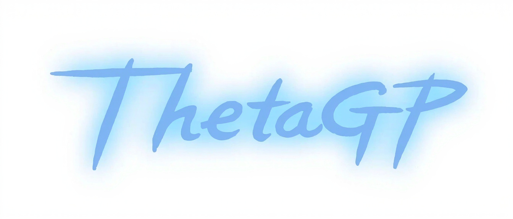

# ThetaGP.Coprocessor

<p align="center">
  
</p>

The panel half of ThetaGP: an ESP32-S3 that drives the display mounted across
the board. A 156x428 NV3007 sits on its side, so LVGL draws the menu on the
quarter turn of it, 428x156: a column of cards that scrolls under the top edge,
an arc in the right third that tracks how far down the column the mark sits, and
the pages behind them, all drawn from a flat palette.

This firmware is not the gamepad's own and never touches USB HID. The screen it
draws is a view of the main board's state: over one UART it greets the board,
beats what is on screen, and takes the navigation steps the board sends, in the
messages of `ThetaGP.PB`.

## What a build needs

| | |
|---|---|
| ESP-IDF | `6.1.0`, with `IDF_PATH` set — `source ~/.espressif/tools/activate_idf_v6.1.sh` |
| CMake | 3.16 or newer, with Ninja |
| `protoc` + python protobuf | the codec of `Link.proto` is generated at configure time; the system Python is preferred, because the ESP-IDF venv has no protobuf |
| the schema | `git submodule update --init lib/ThetaGP.PB` |
| network, first configure only | `lib/CMakeLists.txt` pins and fetches LVGL, nanopb, `esp_lvgl_adapter` and `esp_lcd_touch` into `lib/`; after that the build is offline |
| SDL2 | the simulator only: a system SDL2 is used when there is one, and fetched into `lib/sdl2` when there is not |

Nothing is vendored and the component manager is off: there is no
`idf_component.yml`, `managed_components/` or `dependencies.lock`. A new
component is a new pin in `lib/CMakeLists.txt`.

## Build the firmware

```sh
source ~/.espressif/tools/activate_idf_v6.1.sh   # IDF_PATH, toolchain, idf.py
git submodule update --init lib/ThetaGP.PB       # once per clone

cmake --preset esp32s3                           # configure → build/esp32s3
cmake --build --preset esp32s3                   # debug

cmake --preset esp32s3-release                   # → build/esp32s3-release
cmake --build --preset esp32s3-release           # what a board should run
```

The presets live in `CMakePresets.json`: `esp32s3` (Debug) and
`esp32s3-release`, each keeping its tree under `build/<preset>/`. Re-run the
configure after changing `main/CMakeLists.txt`, `lib/CMakeLists.txt`, the
schema or a `sdkconfig.defaults` value; a plain build does not pick those up.

`idf.py build` works too (tree in `build/`, `sdkconfig` seeded from
`sdkconfig.defaults`), but the presets are what the repository configures with.

The output is `build/<preset>/ThetaGP.Coprocessor.elf` next to its `.bin`.

`sdkconfig` is generated and gitignored; delete it if a change to
`sdkconfig.defaults` does not take effect.

## Flash and watch

The console is **USB-Serial-JTAG on the board's own USB port** (GPIO19/20), not
the debug probe. The port number moves between flashes, so find it by its name:

```sh
ls -l /dev/serial/by-id/usb-Espressif_USB_JTAG_serial_debug_unit_*-if00
# usb-Espressif_USB_JTAG_serial_debug_unit_E8:F6:0A:84:40:7C-if00 -> ../../ttyACM2
```

```sh
python3 $IDF_PATH/tools/idf.py -B build/esp32s3-release -p /dev/ttyACM2 flash
python3 $IDF_PATH/tools/idf.py -B build/esp32s3-release -p /dev/ttyACM2 monitor
```

A board that came up right says, in this order:

```
nv3007: io ESP_OK (0), 60000000 Hz asked
I (1149) esp_lvgl:adapter: LVGL adapter initialized successfully
I (1172) esp_lvgl:adapter: LVGL task started successfully
nv3007: 428x156 ready
panel: backlight on
link: codec ok
link: loopback ok (7/7 B)
link: uart1 4000000 baud, tx 4 rx 5
link: ready
link: board BoringTechH743 0.3.0
```

`link: board …` is the main board answering its greeting: the whole path —
UART, framing, decode, dispatch, the model — is working. The panel driver and
the adapter are on SPI2 at 60 MHz; the link is UART1 at 4 Mbit/s.

## Build and run the simulator

The simulator compiles the real `main/ui/` sources on this machine and draws
into an SDL window instead of the panel. It is the fast way to check a UI
change, and it is what the frame comparison runs on.

```sh
python3 simulate/launch.py                 # configure, build, run
python3 simulate/launch.py --clean         # throw the build tree away first
python3 simulate/launch.py -- --dump /tmp/frame.ppm   # headless: one frame
```

Keys: `up`/`left` previous, `down`/`right` next, `enter` open, `backspace`
back. Everything after `--` goes to the binary (`--scale F`, `--dump FILE`).

By hand, if you would rather:

```sh
cmake -S simulate -B simulate/build
cmake --build simulate/build
```

The simulator never compiles `nv3007_lcd.cpp`, `lvgl_display.cpp`,
`button.cpp` or `link.cpp`: it validates the UI, not the panel driver, the
adapter or the wire.

## Check what a change did

```sh
simulate/build/compare        # one frame hash per step of a fixed script
simulate/build/frame_test     # the link's framing, on this machine
```

`compare` drives the menu through a fixed script on a fake clock — the home
cards, a move interrupted by a move, the profile level's names, menu, window
and values, model updates — and prints one hash a frame. Two builds of the same
program that print the same lines draw the same picture, which is how a
refactor is shown not to change the panel. To compare against another commit,
`git worktree add` it, build the same target there, and `diff` the two outputs.

## Where things are

```
main/
  main.cpp            app_main, only calls Coprocessor
  app/                boot order, the protocol loop, the board button
  wire/               frame (framing + a queue of whole frames), dispatch
                      (read one payload, route it into an inbox)
  protocol/           Link.proto session: hello, beat, apply; the transport and
                      panel seams the app fills in
  ui/                 model, menu, splash, theme, spring, pages/, profile/,
                      widgets/, assets/
  drivers/            display/ (esp_lcd panel, its sequence, the adapter),
                      input/ (the board button), link/ (the UART and its task)
```

Dependencies only point down: `app → protocol → wire`, `app → protocol → ui`,
and `app → drivers`. `ui/` includes neither `protocol/` nor `drivers/`, and
neither `protocol/` nor `wire/` names a driver — the app hands the session the
wire and the panel at `init`.

Both cores are used: the LVGL task on core 0 with the app loop, the link task
reading its UART on core 1, and the frame queue as the only thing between them
— one producer, one consumer, each index written by one task, so it needs no
lock. `AGENTS.md` has the invariants that keep it that way, and
`docs/restructure-plan.md` (a local note, not tracked) records how the tree got
here and why the two cores are split this way.

## Licence

GPLv3. `main/pb/` is generated from `ThetaGP.PB` and is not tracked.
